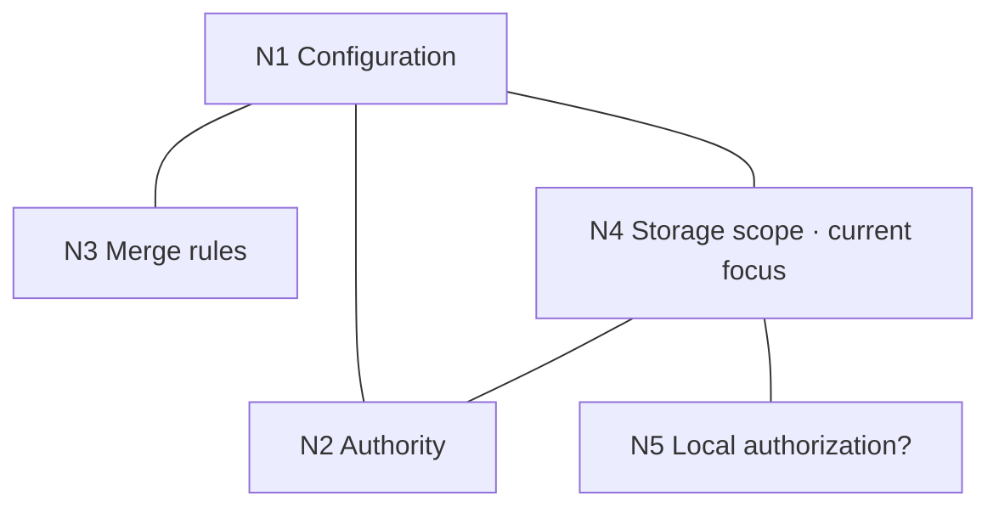

# Working Graph

**A live problem map for AI agents.**

> **The conversation is linear. The problem isn't.**

Architecture reviews branch. Debugging produces competing explanations. Research uncovers questions that matter later.

Working Graph gives your agent a lightweight Markdown map of that evolving problem: **what matters, how it connects, where the current focus is, and where the evidence lives.**

When a useful side question appears, put it on the map and keep going. Return to it when it matters.

## Try it

Install with the [Skills CLI](https://github.com/vercel-labs/skills):

```bash
npx skills add xiaqi4426-demo/working-graph --skill working-graph
```

Then ask your agent:

```text
Use the working-graph skill for this architecture review.
Read the skill and maintain the graph as the problem evolves.
```

The agent keeps the active graph in `.working-graph/graph.md` inside your project and reuses it when continuing the same problem. The skill supplies instructions, a template, and examples; your agent reads and updates the files.

The CLI requires Node.js/npm. Using the skill requires an agent that can load skill instructions and read/write project files. For manual installation, copy `SKILL.md`, `graph-template.md`, and `examples.md` together into a `working-graph` folder in your agent's supported skills location.

## A side question without losing the thread

An illustrative architecture review starts with configuration and branches into authority, merge rules, and storage:



While investigating storage scope, the agent notices that local authorization may need separate treatment. It adds a small card:

```markdown
### N5 — Local authorization?

**Summary**

Check whether device-local grants should be excluded from configuration sync.
Deferred while storage scope is clarified.

**Refs**

- None yet; inspect the relevant configuration sources when this branch resumes.
```

One relation summary explains why N4 and N5 connect. Focus stays on N4 unless the new question blocks it. When that branch is complete, the agent can inspect the map and return to N5.

The example illustrates the intended workflow; it is not a measured comparison or a recorded agent run.

## How it works

| Layer | Purpose |
| --- | --- |
| **Map** | Show the important points, their connections, and current focus. |
| **Node card** | Explain one point, its nearby relationships, and where to look next. |
| **Artifacts** | Keep the detailed evidence in files, code, papers, experiments, or other source material. |

A node needs a stable `id`, a `title`, a short `summary`, and zero or more `refs`. It can represent a question, hypothesis, constraint, finding, decision, or deferred direction.

An edge records a relationship. Direction is optional; its meaning is explained in ordinary language. Each relation explanation is stored once and read with either connected node.

**Schema-light, protocol-strong:** keep the reading and editing conventions clear, and let the task determine the graph's contents.

## When it helps

Try it on architecture reviews, debugging, research, or design discussions where:

- several branches affect one another;
- new side questions repeatedly interrupt the current work;
- rejected directions are worth remembering;
- the work continues across sessions or context changes;
- detailed evidence is spread across several artifacts.

For a short, linear task, work directly. The graph should earn its maintenance cost.

## How it fits with existing tools

| Tool or state | Main question |
| --- | --- |
| Transcript | What happened? |
| Memory | What should be retained across time? |
| Context | What should the model see right now? |
| Plan / todo | What should happen next? |
| Artifact | Where is the detailed material? |
| **Working Graph** | **What does the problem look like, where are we in it, and how do its parts connect?** |

The graph represents the agent's current working interpretation. Update it when understanding changes, and check referenced evidence before relying on a claim.

## Status and feedback

**Experimental.** This release is a Markdown skill with a template and examples. Its usefulness during long, complex work still needs evaluation through real use.

Useful feedback includes whether it preserved a deferred question, avoided repeating a rejected path, or became too costly to maintain. Open an issue with a small example of the task and what happened.

## Read more

- [Skill instructions](SKILL.md)
- [Graph template and editing conventions](graph-template.md)
- [Behavior examples](examples.md)
- [Original concept and design rationale](docs/concept.md)

## License

[MIT](LICENSE).
