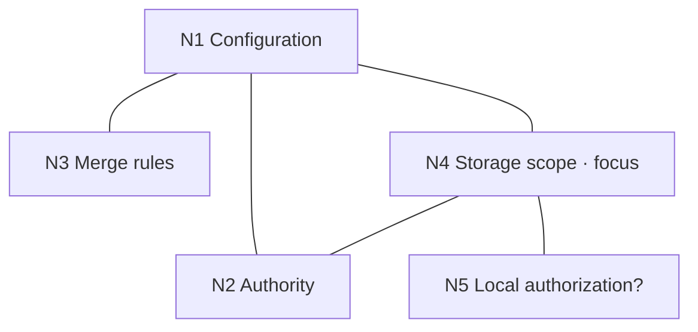
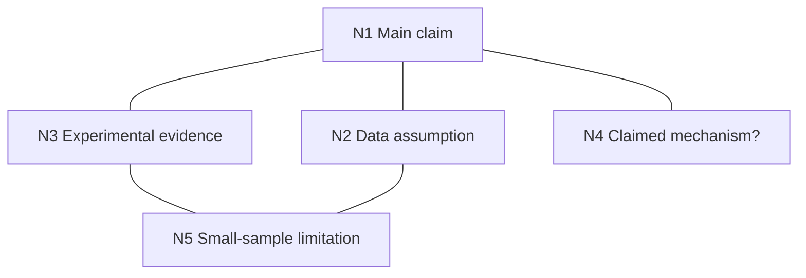

# Working Graph Examples

These are illustrative scenarios, not recorded evaluations. Read the relevant example when deciding how to maintain a graph.

## Architecture review

A configuration discussion reveals that authority, merge rules, storage locality, and local authorization are related but distinct.

The N4 card explains that where state is stored and whether it is synchronized are questions independent of authority. A relation summary for N4 and N5 records why local grants raised the storage question. A separate N4–N2 relation explains the independence of these dimensions.

Keep focus on N4 while parking N5, unless N5 blocks the current investigation. Avoid inventing a `ConfigurationIssueNode` taxonomy or creating a node for every discussion message.

## Debugging

An intermittent request failure has several possible explanations:

| ID | Point | Current working interpretation |
| --- | --- | --- |
| N1 | Request failure | Overall investigation. |
| N2 | Parser | Rejected by the inspected evidence; keep the reason and source ref. |
| N3 | Cache | Rejected by the inspected evidence; keep the reason and source ref. |
| N4 | Retry path | Current focus. |
| N5 | Upstream timeout | Related condition; not yet established as the root cause. |
| N6 | Retry loses request body | Finding to verify against the retry implementation and reproduction. |

Connect N1 to N2–N5, and connect N4 to N6. Keep rejected explanations when they prevent repeated investigation. Attach the actual reproduction and source refs when available; these illustrative labels are not evidence.

Commands such as `rg`, `pytest`, and `git diff` are actions used to investigate the nodes. They usually do not need their own nodes.

## Paper analysis

N4 may remain a placeholder while the mechanism is unclear. The N2–N5 relation can explain why the available sample may not establish the distributional assumption. Reference the relevant paper sections rather than copying the paper into the graph.

## Parking a side question

Current focus: **N8 — Context invalidation**.

A provider fallback question appears. If it does not block N8, create **N12 — Provider fallback semantics?**, connect it to the relevant node, and give it a short summary: “May affect capability routing; deferred while context invalidation is resolved.” Keep focus on N8.

When N8 is complete or blocked, inspect the graph and decide whether N12 is now relevant. Creating a node does not automatically make it the next task.

## Continuing a previous session

Read the existing graph's Scope, Focus, Map, focused card, and immediate relation summaries. Open refs relevant to the current task. If new evidence changes a conclusion, revise the affected card and connections.

Continue the existing IDs and preserve useful deferred or rejected branches. If the user has switched to an unrelated problem, use a separate graph with an explicit scope.

## Work already using multiple agents

When a task already delegates work, give each agent its local card, nearby relations, refs, and enough upstream context to understand the goal. The coordinating agent can integrate concise changes such as a new finding, resolved question, or added ref.

Keep detailed outputs in their artifacts. A shared Markdown file does not itself provide locking or concurrent merge behavior; coordinate edits using the facilities already available in the project.
