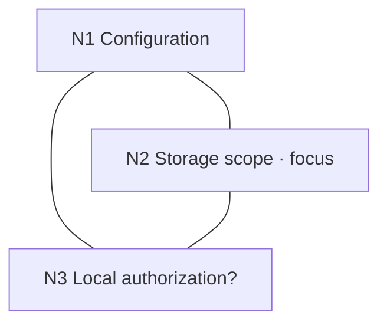

# Working Graph Template

Use this file when initializing or repairing a graph. Copy the template block below into the active graph file, normally `.working-graph/graph.md` in the user's project, and replace the example content with the actual problem. Keep only nodes and relations the task needs.

## Template

````markdown
# Working Graph

## Scope

Clarify a configuration model. File refs are relative to the project root.

## Focus

N2 — Storage scope

Clarify storage locality before investigating the deferred authorization question.

## Map



## Nodes

### N1 — Configuration

**Summary**

Work out which dimensions the configuration model needs to represent. Storage and local authorization are the current concerns.

**Refs**

- None yet.

### N2 — Storage scope

**Summary**

Clarify where configuration is stored and whether it is synchronized. This is the current focus.

**Refs**

- None yet.

### N3 — Local authorization?

**Summary**

Check whether device-local grants require separate treatment. Deferred while storage scope is clarified.

**Refs**

- None yet.

## Relations

### N1 --- N2

Storage scope is one dimension of the configuration model.

### N1 --- N3

Local grants are a concrete configuration case the model needs to cover.

### N2 --- N3

Whether local grants are synchronized depends on how storage locality is represented.
````

## Editing conventions

- Keep IDs stable. Use short IDs such as `N1`, `N2`, and `N3`; do not renumber existing nodes for appearance.
- Keep titles short and summaries sufficient to judge relevance without opening every ref.
- Store each relationship explanation once in **Relations**. A node's effective card includes its node section, refs, and every relation record touching it.
- Use `---` for a connection and `-->` only when a reading direction matters. Explain the meaning in the relation summary; arrows have no universal semantics.
- Keep **Focus**, **Map**, **Nodes**, and **Relations** consistent when adding, splitting, or consolidating nodes. Every ID used in the map, focus, or a relation must have a node card; a short placeholder card is sufficient.
- Describe unresolved, deferred, rejected, and completed states in ordinary language. A fixed status taxonomy is unnecessary.
- Use precise refs to existing files, sections, symbols, commits, or sources. State the base for relative file paths, normally the project root. Write `None yet` when there is no source; do not invent evidence.
- Keep details in source artifacts. The map or a brief table should show orientation, not reproduce every explanation.

Mermaid is one readable map format, not a runtime dependency. A compact node/connection table is also sufficient when diagrams are unavailable.
